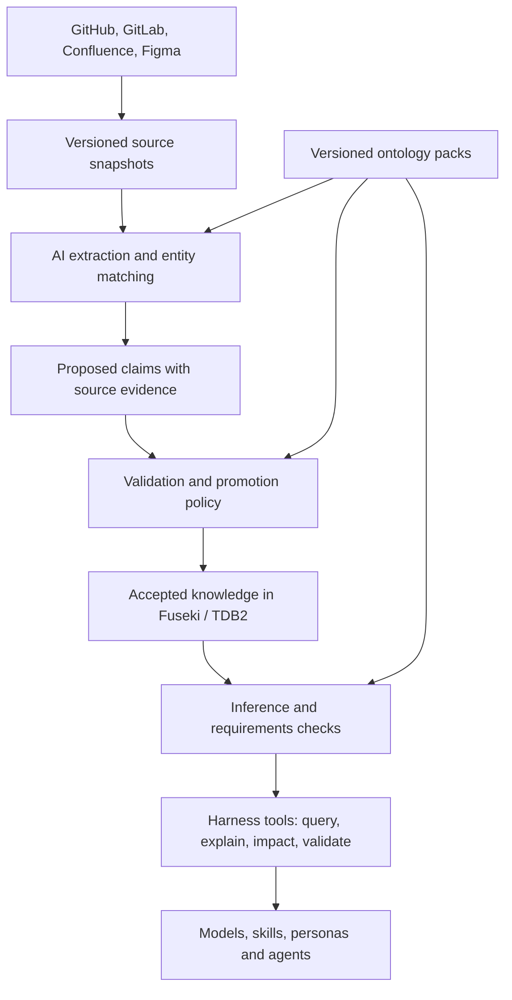

# Conversation transcript — airline semantic knowledge service pilot

Export prepared: 21 November 2026.

Scope: the user-authored discussion and assistant replies from the initial project exploration through the request for this export. Original wording, including spelling, is retained. Assistant progress updates and questions presented through the input tool are included. Internal instructions, private reasoning, raw tool calls/results and the machine-generated environment context are not part of this conversational transcript. The environment was the JSSGDBC repository on the user's personal machine. Local file/tool research is summarized in the companion `local-knowledge-pilot-plan.md`.

The transcript ends at the export request; messages generated while preparing the export are not included. Read the companion plan first for a concise, self-contained handoff.

---

## 1. User — initial exploration request

This project is a simple attempt at jsdbc like standardisation of access to semantic web servies, staring with RDF style triplets.  It currently sits below the ontology (RDFS and OWL) layer, but I would like it to support interaction with RFDS and OWL onotolgy packs, as well as inference - taking perhpas Apache Jena as the reference guide.

More specifically this project is only a bottom up means to an end; I would like to use eitrher Apache Jena itself (locally in docker or depoyed in k8s) to build out a determinitsic knowldege gragh (base) with query inference, that I can use in my LLM harness to be more rigorous and deterministic about my project requirements; I am interested in standard OWL schema across IT domains and commerical domains (airlines, travel, finance, etc) that can be used by the LLM to populate Jen (or other) from a diverse and chan ging corpus of requirements in systems like GitHub, GitLab, Confluence, Figma and more.

Lets step outside the grounded bounds of this project and explore a plan for how to use Jena or similar, to use AI to collate and or create relevant ontology packs, the ingest and populate a local senamtic web service (that can be migrated and shared as a remote service) as a companion to regular frontier AI models and harness (skills, pewrsonas, agents).

Ask em questions, explore the problem space and create a plan moving forward on the wider goal as a priority - as a subordinate step, we can think about next teps for this little vanity project.

You can read the initial project details in the .gsd folder (it was built with Open GSD)

### Assistant — progress update

I’ll read the `.gsd` context, then explore the wider knowledge-base architecture and ontology options. I’ll start with a few questions about what you want the harness to prove or check, since that will shape both the inference model and the ingestion process.

### Assistant — questions presented during research

What should the first useful version help your LLM harness do?

- Trace requirements to sources, decisions, implementation and tests
- Detect conflicting, missing or unsatisfied requirements
- Apply domain rules to derive new facts and answer questions

Is there a particular project or domain you can use as a pilot, and which source systems hold its requirements?

How should AI-extracted knowledge become trusted?

- AI proposes facts and ontology changes; I approve them before promotion
- Automatically promote well-supported facts; review ambiguity and ontology changes
- Start with an exploratory graph and introduce approval controls later

### Assistant — progress update

The `.gsd` records show JSSGDBC already has SPARQL and Neo4j adapters, although the root README still describes them as future work. More importantly, Jena’s built-in OWL reasoning is incomplete: we should choose and test the inference rules your harness needs explicitly. Missing requirements, conflicting source claims, and logical entailment also need different treatment; an OWL ontology alone won’t handle all three.

### Assistant — response

I would start with **Jena/Fuseki as the reference implementation of a versioned requirements knowledge service**, with AI proposing structured knowledge and deterministic machinery validating and querying it.

The central design question is: **what should the harness be able to establish, from which evidence, under which assumptions?** Choosing ontology packs follows from that.

I read the `.gsd` project, requirements, decisions and state documents. JSSGDBC already supplies useful connectivity, including a SPARQL adapter. The broader system needs its own architecture; it should drive subsequent JSSGDBC extensions.

**The distinction that matters most**

There are three different capabilities here:

| Capability | Example | Proposed mechanism |
|---|---|---|
| Semantic inference | Every payment service is a service; therefore this payment service inherits service classifications | RDFS/selected OWL constructs |
| Requirements validation | Every approved requirement must have an owner and acceptance criteria | SHACL and explicit checks |
| Project reasoning | A changed requirement affects these components and invalidates these verification results | Versioned rules and SPARQL queries |

OWL uses an **open-world assumption**: an absent fact is not necessarily false. Consequently, “no test is recorded” does not establish “no test exists.” We must explicitly define the source coverage and snapshot within which completeness checks apply. [W3C OWL primer](https://www.w3.org/TR/owl2-primer/)

Likewise, deterministic inference does not make AI extraction correct. The useful guarantee is narrower: **given the same accepted facts, ontology versions and rules, return reproducible conclusions with inspectable evidence.**

**A proposed architecture**

I would preserve four distinct kinds of information:

- **Evidence:** source identity, revision, exact passage or design-node reference, retrieval time.
- **Claims:** what the source says, who extracted it, uncertainty, scope and approval state.
- **Accepted assertions:** the facts selected for a particular project baseline.
- **Derived conclusions:** consequences of those assertions under a specific ruleset.

This lets GitHub and Confluence disagree without silently overwriting one another. “Document A states X” and “document B states Y” can both be accurate records of conflicting claims.

Named graphs can separate these datasets, but claim-level provenance still needs an explicit model. PROV-O is a useful foundation for derivation, activities and attribution. [W3C PROV-O](https://www.w3.org/TR/prov-o/)

For changing sources, retain history and supersede claims. Rebuild derived results for each baseline initially; optimize incremental updates only after correctness is demonstrated. Source deletion must not leave obsolete inferred facts behind.

**Jena is a reasonable starting point—with a defined reasoning contract**

Fuseki exposes SPARQL query/update and Graph Store protocols; TDB2 provides persistent transactional storage. This supports a local Docker deployment whose clients can later address a remote endpoint. [Fuseki documentation](https://jena.apache.org/documentation/serving_data/), [TDB2 documentation](https://jena.apache.org/documentation/tdb2/index.html)

However, Jena’s built-in OWL reasoners implement useful but incomplete subsets. Loading an OWL ontology does not mean all its semantics will be enforced or inferred. I would begin with a tested set of RDFS entailments and explicit application rules, plus SHACL validation. Configure exactly which ontology and assertion graphs each inference view includes. [Jena inference](https://jena.apache.org/documentation/inference/), [Jena SHACL](https://jena.apache.org/documentation/shacl/)

If the pilot demands sophisticated OWL reasoning, evaluate a separate reasoner against those actual requirements. If frequent changes and incremental rule maintenance dominate, RDFox is a candidate to benchmark: its documentation describes materialization and explanation facilities. [RDFox reasoning](https://docs.oxfordsemantic.tech/reasoning.html)

For Kubernetes, initially use one database-owning Fuseki instance with persistent storage, backups and a tested restore procedure. Replicas sharing the same database directory are not a scaling strategy.

**Ontology packs should be tested software dependencies**

I would define a pack as more than an OWL file:

- Ontology, pinned imports and explicit supported reasoning features.
- SHACL shapes and domain rules.
- Mappings from source terminology into canonical concepts.
- Example data, expected inferences and expected validation failures.
- Version, license, provenance and migration notes.

Start with a small requirements vocabulary—requirements, decisions, components, acceptance criteria, verification evidence and source revisions—then add domain modules.

Some concrete reuse candidates:

| Area | Starting point | Intended use |
|---|---|---|
| Requirements and engineering lifecycle | [OSLC vocabularies](https://www.open-services.net/specifications/vocabularies/) | Align requirements and lifecycle links with established terms |
| Provenance | [PROV-O](https://www.w3.org/TR/prov-o/) | Record sources, extraction and derivation |
| Finance | [FIBO](https://edmcouncil.org/frameworks/industry-models/fibo/) | Evaluate relevant finance modules and their dependencies |
| Airlines | [IATA AIDM](https://www.iata.org/aidm) | Industry vocabulary and relationships; assess representation and reuse terms |
| Travel | [Schema.org reservation vocabulary](https://www.schema.org/LodgingReservation) | Lightweight interoperability for travel entities |

These are different kinds of assets, not interchangeable ready-made OWL reasoning packs. In particular, industry data models may require mappings or curated OWL representations.

AI can compare candidates, propose mappings, draft missing concepts and generate test fixtures. Promotion should depend on review and executable semantic tests. AI-proposed equivalence between concepts deserves particular scrutiny: a mistaken equivalence can propagate across the entire graph.

**A practical sequence**

1. **Define the pilot through questions.** Select one project, one or two source systems, and roughly ten questions the service must answer. Include traceability, missing evidence, change impact and contradictory requirements.

2. **Build a small curated reference dataset.** Use perhaps 30–50 requirements with deliberately ambiguous, conflicting and superseded examples. Establish expected answers manually before automating extraction.

3. **Implement one complete local path.** Source snapshot → proposed claims → validation → accepted baseline → inference → explained query result. Demonstrate re-ingestion, correction and removal.

4. **Introduce AI extraction.** Measure extraction precision, entity-matching errors, unsupported assertions and review effort against the reference dataset. Preserve ambiguity rather than forcing every passage into a fact.

5. **Connect the harness.** Expose tools such as `trace_requirement`, `explain_conclusion`, `assess_change_impact` and `validate_baseline`. Return evidence and baseline identifiers alongside results. Claims of completion should require recorded verification evidence.

6. **Expand and deploy remotely.** Add a second domain pack and source connector to test modularity, then address shared access, source permissions, operational recovery and Kubernetes deployment.

A useful first acceptance test would be: **change a source requirement, identify the affected components and tests, withdraw outdated conclusions, and explain every resulting finding.**

For JSSGDBC, the likely follow-on work is capability discovery, richer RDF term handling, general SPARQL access, bulk operations and explicit inference-view selection. Ontology lifecycle and approval policy belong in the higher-level service until the pilot demonstrates a reusable abstraction.

I’ve sent three discovery questions about the first useful capability, pilot project and promotion policy. The most valuable starting point is: **what are two or three concrete questions your current LLM harness answers unreliably that you want this service to answer rigorously?**

---

## 2. User — airline delivery context

I work for an airline, we are building a small business loyalty rewards system, but the presiding org structure means the teabs building the software are working independantly (in silos) and there is significant co-ordination cost in alignment - there is a product team (business), a design team (creative &  comms), a business analyst team, web front end (digital) team delivering a SSR app (with bundledd BFF) in node.js, an "integration" team delivering API facades (Springboot Java) dicided into design teams and separate implementaion staff,, and various teams for systems of record for identity, crm, booking engine, loyalty (Ping One, Salesforce, Sabre, Amadeus Loyalty), add in an enterprise acrhitecture team and a platform team, for good measure - across these streams context based knowdlege sets quickly outgrow the context window, so a better shared source of truth is required - enter Apache Jena opr similar - does that frame the problem space?

### Assistant

Yes—that frames it much more precisely. **The primary problem is maintaining shared, traceable meaning across delivery teams**, with an airline loyalty domain providing the business context.

Each team holds a partial view of the same system:

| View | Examples of knowledge it owns |
|---|---|
| Product | Business outcomes, eligibility, reward policies |
| Design and communications | Journeys, interaction states, customer-facing promises |
| Business analysis | Rules, exceptions, acceptance criteria |
| Web/BFF | User-facing behaviour, orchestration, session assumptions |
| Integration | API contracts, mappings, error semantics |
| Systems of record | Authoritative identities, bookings, membership and balances |
| Architecture/platform | Boundaries, constraints, deployment and operational policies |

The shared knowledge service should connect those views while preserving their ownership and evidence. It need not replace the tools where each team works.

For example, consider this **hypothetical** requirement:

> An eligible small business earns rewards when an employee completes qualifying travel.

That sentence conceals coordination questions:

- What establishes that a business is eligible, and which system owns that status?
- How is an employee linked to a business, and at what point must that relationship be valid?
- Does “completes travel” mean a booking status, ticket status, or flown segment?
- Which cancellations, refunds or retrospective changes reverse an award?
- What may the website promise before the loyalty system confirms the award?

An ontology gives those concepts explicit meanings. The project knowledge graph connects them to decisions, API fields, source-system states, screens, implementation work and tests. Rules and validation checks identify where those connections disagree or remain unspecified.

**That changes what I would prioritize.** Start with a shared vocabulary and traceability across one business journey. Introduce domain inference where it answers a demonstrated question. A large airline ontology imported upfront would leave most of your coordination problem untouched.

There are also two distinct graphs to keep conceptually separate:

- **Knowledge about the system being built:** requirements, contracts, ownership, rules, decisions, dependencies and verification.
- **Operational business facts:** actual businesses, employees, bookings and reward transactions.

Your immediate need appears to be the first, supplemented by synthetic business scenarios for checking behaviour. We should establish that boundary before deciding whether operational data belongs in scope.

For the context-window problem, the harness would retrieve a **task-specific evidence package**. A developer changing employee enrolment might receive the applicable business rules, identity assumptions, API contracts, affected journey states, unresolved decisions and relevant tests—with their sources and revisions. The graph makes those relationships explicit; the original documents remain available for detail.

The difficult part will be authority and disagreement. The service should be able to say:

> Product specifies A; the integration contract implements B; no recorded decision resolves the difference.

It should not silently choose one, or ask an LLM to blend them into a seemingly consistent answer. “Shared source of truth” will work better here as **a shared record of accepted decisions, competing claims and unresolved gaps**.

I would use one journey—business enrolment, employee association, reward accrual or redemption—as the first vertical slice. Success would mean catching a real cross-team mismatch and showing its downstream consequences.

Three questions would sharpen that pilot:

1. **Which journey currently causes the most alignment trouble?** A concrete recent misunderstanding would be especially useful.
2. **Where do the competing versions of the requirements live?** For example, Confluence business rules, Figma designs, Jira stories, OpenAPI specifications and code—and is any source formally authoritative?
3. **Who can resolve a disagreement across teams?** Is there an accountable product owner or design authority, or must the system track agreement among several owners?

---

## 3. User — distributed harness and shared service

Each area has well defined ownership, but clearly co-ordination, de-duplication, source citation, and clarity needs to foregrounded as the ingestion of sources updates over time.  The bigger issue is how a consolidated workflow can align on a source of truth (remote) using a distributed harness (read as set of skills, personas deployed in a codex, claude or similar) that can query the knowldege base specifically and recieve up to the minute, accurate and deterministic information so that distributed agents can work on clarifyuing requirements, the figmas, the web front end, the spring integration facades, and config elements in the system of record in an aligned way.  Doing that in islotaion in each desktop, chat window, or CLI (repo) is not going to scale.

### Assistant

Yes. **The target is a shared coordination service for distributed agents**, with the knowledge graph supplying its semantic foundation. Each Codex, Claude or other harness becomes a client of the same governed project state.

That moves the architecture beyond “retrieve relevant documents.” Agents need a common protocol for reading authoritative knowledge, proposing changes, detecting stale assumptions and recording what they acted on.

**The service should own the coordination contract**

I would separate three responsibilities:

| Responsibility | What it provides |
|---|---|
| Knowledge base | Concepts, claims, relationships, source citations, ownership and history |
| Coordination service | Accepted baselines, change proposals, conflict handling, freshness and impact analysis |
| Distributed harness | Skills and personas that use the service to perform work in each team’s tools and repositories |

Jena is a candidate for the first responsibility. The second requires application logic around it. Skills and personas consume that logic; they should not independently recreate it.

For example, a frontend agent should be able to request:

> Give me the accepted requirements for business enrolment, including relevant Figma states, BFF and integration contracts, identity rules, outstanding disagreements and changes since my last baseline.

The response should be a structured contract with evidence—not just an AI-generated summary.

**Every answer needs an explicit knowledge boundary**

“Up to the minute” needs a precise meaning. The service cannot know about a Confluence change it has not ingested, or treat a newly extracted statement as an approved requirement.

I would make every response carry:

- **Baseline identifier:** the accepted project state used for the answer.
- **Source revisions and citations:** including the passage, design node or contract element supporting each assertion.
- **Freshness:** when each relevant source was last successfully synchronized, and whether updates await processing.
- **Status:** accepted, proposed, disputed, superseded or unknown.
- **Derivation:** which rules produced an inferred conclusion.
- **Coverage gaps:** relevant sources that are unavailable, stale or not yet mapped.

That allows an agent to distinguish “accepted and current within synchronized sources” from “latest source content is still being reconciled.” A failed ingestion must never look like an absence of new requirements.

**Agents should work against a baseline, then check for changes**

Always reading a moving “latest” state can itself create inconsistency. An agent might read eligibility rules before an update and an API contract after it.

I propose this workflow:

1. **Acquire a task context.** The service returns a consistent baseline and the requirements, contracts and constraints relevant to the task.
2. **Perform the work.** The agent records which knowledge identifiers and revisions its implementation depends on.
3. **Submit discoveries and proposals.** Ambiguities, missing mappings and suggested requirement changes enter the shared service with evidence.
4. **Reconcile through existing ownership.** The relevant owners resolve semantic changes; validation checks establish structural consistency.
5. **Check freshness before completion or merge.** The service identifies whether accepted changes affect the agent’s assumptions. Material changes require reconciliation.
6. **Record implementation and verification evidence.** Link the resulting commit, design revision, contract or configuration change back to the requirements it addresses.

This preserves coherent work while ensuring that stale assumptions become visible. Notifications can accelerate the loop, but the final freshness check is still necessary.

**Ingestion becomes a continuous reconciliation process**

For each source update, the pipeline should determine:

- What changed in the source?
- Which existing claims does that change revise?
- Is this another citation supporting an existing requirement, or a distinct requirement?
- Does it conflict with accepted knowledge?
- Who owns resolution?
- Which downstream artifacts and active tasks depend on it?

De-duplication must preserve evidence. Two documents expressing the same rule can support one canonical requirement while retaining separate citations. Similar wording alone must not merge rules with different applicability, dates or exceptions.

Likewise, ownership and source authority should be explicit data. A design can establish an interaction state without automatically overriding a product eligibility rule. Where those views disagree, the service records the mismatch and routes it to the established owners.

**Keep the harness portable and the policy central**

A shared API, optionally exposed through MCP, could provide operations such as:

| Operation | Purpose |
|---|---|
| `get_task_context` | Obtain a bounded, cited context at a consistent baseline |
| `query_accepted_knowledge` | Answer a specific question with explicit scope and status |
| `explain_assertion` | Retrieve evidence and derivation |
| `propose_change` | Submit a proposed fact, mapping or correction |
| `assess_change_impact` | Find affected requirements, contracts, artifacts and tasks |
| `check_baseline` | Identify relevant changes since work began |
| `record_verification` | Attach test or review evidence to a particular implementation and requirement revision |

These are proposed service operations, not existing Jena features.

The skills tell agents when and how to call them. Personas tailor the perspective—business analyst, designer, frontend developer, integration developer—but all use the same identifiers, authority rules and baseline semantics.

For consequential workflow gates, enforce those checks in CI or the delivery workflow as well. A skill instruction alone cannot guarantee that every agent follows the protocol.

**The first pilot should prove distributed alignment**

I would now make the pilot two agents working on the same journey from separate environments: one on the web/BFF, another on a Spring integration facade.

Introduce an accepted requirement change while both are working. The pilot succeeds if:

- Both retrieve the same initial business meaning and contract.
- The change is ingested with citations and ownership intact.
- The service identifies which work is affected.
- A stale completion attempt is detected.
- Both implementations reconcile to the new baseline, with linked verification evidence.

That tests your actual scaling problem much more directly than demonstrating ontology loading or SPARQL queries.

The next architectural decision is **how authoritative this shared service should become**: should it initially observe and reconcile decisions made in existing tools, or should cross-team requirement and contract changes be proposed and accepted through it—with the existing tools remaining the authoring surfaces?

---

## 4. User — local pilot before EKS

Initially, this should be a local-only pilot, where I ingest all the disparate streams and sources locally on a period (tracking change over time), with a view to distributing the knowlegde service via the platform teams hosting in K8s(EKS) and giving teams a plugin (skills etc) that can do the same (based off a local cross-functional set possibly curated for intent (web, api, ba,  creative).

### Assistant

That gives us a clear deployment path: **prove the full cross-functional workflow locally, then move the knowledge service to EKS and distribute role-specific clients.** The local pilot should exercise the same service boundary that remote clients will eventually use.

I’m interpreting “local-only” as local storage, ingestion processing and serving, with periodic access to the original source systems. Whether extraction can use hosted frontier models is a separate choice.

**The pilot has three deliverables:**

| Deliverable | Purpose |
|---|---|
| Local knowledge service | Stores source history, proposed and accepted claims, ontology packs, and queryable project baselines |
| Periodic ingestion pipeline | Collects changes, reconciles claims, preserves citations, and reports freshness |
| Local cross-functional harness pack | Provides shared protocols plus web, API, BA and creative perspectives |

The role-specific packs should be **different views over shared knowledge**. A web-focused agent still needs relevant API and identity constraints; an API-focused agent still needs the business rule and customer journey that justify its contract.

For the local service, I would start with Docker Compose containing Fuseki/TDB2 and a small application service. Keep source snapshots, ingestion metadata and processing jobs outside the triple store where ordinary files or a small relational database are simpler. The graph holds semantic relationships and references to that evidence.

Expose the application service over localhost from the outset. The harness uses its API or MCP tools rather than accessing database files directly. Moving to EKS then changes deployment, authentication and operations while preserving the client contract.

**Periodic ingestion should produce reproducible knowledge releases.**

Each run would:

1. Fetch changes using source revision identifiers or cursors where available; use content hashes for exports.
2. Preserve the original evidence and record collection success, failure and coverage.
3. Extract proposed claims and reconcile them against existing identities and claims.
4. Identify additions, semantic changes, conflicts and apparent removals.
5. Apply validation and the pilot’s promotion policy.
6. Publish a new accepted baseline, with an impact report and source freshness manifest.

A missing item in a partial fetch must not be interpreted as deletion. A failed source synchronization must leave an explicit freshness gap.

For the pilot, you can act as curator across the streams while preserving the real organisational ownership in the model. That tests reconciliation without needing to introduce an approval workflow across the organisation immediately.

**The first ontology pack should describe delivery coordination.**

Start with:

- Business concepts and rules.
- Requirements and acceptance criteria.
- Journeys, screens and interaction states.
- APIs, operations, fields and error semantics.
- Systems of record and ownership.
- Decisions, assumptions and unresolved questions.
- Implementation artifacts and verification evidence.

Then add a small loyalty-domain module for the selected journey. This gives us a useful test of ontology reuse without requiring a comprehensive airline model first.

The harness pack would have a common foundation—citation requirements, baseline handling, freshness checks, proposal submission—and focused workflows:

| Perspective | Initial workflow |
|---|---|
| BA/product | Reconcile requirements, identify ambiguity, trace decisions |
| Creative/design | Check journey states and customer-facing promises against accepted rules |
| Web/BFF | Retrieve implementation constraints and identify contract gaps |
| API/integration | Check mappings, ownership boundaries and system-of-record assumptions |

All should return “unknown” or “disputed” when appropriate, and distinguish source assertions from accepted decisions and inferred conclusions.

**I would sequence the work into four milestones.**

1. **Evidence and history:** ingest one journey from a few representative sources; prove citations, revisions and change detection.
2. **Semantic baseline:** curate the initial vocabulary and claims; implement deterministic queries and validation checks.
3. **Cross-functional harness:** use separate local agent sessions to work from the same baseline; demonstrate a source change affecting both.
4. **Deployment readiness:** package the service for remote hosting, test backup/restore, and define authentication, source-access boundaries and team-specific retrieval.

Source-access metadata should be captured during the pilot, even if you are its only user. Later, a consolidated service must respect who may see the underlying evidence and derived information.

JSSGDBC stays subordinate: use its existing SPARQL functionality where it fits, and let demonstrated pilot needs determine extensions.

Two choices will make the first milestone concrete:

- **Which journey and source formats can you start with?** For example, business enrolment with Confluence exports, Figma content and OpenAPI files.
- **May hosted models process the ingested material, or must extraction also run entirely on your machine?**

---

## 5. User — two slices and existing identity agreement

We already have an inprogess slice (not enrollment - we have manually created a business account) that includes login woith atest account, hit an API (in-prgesss development non-AI) that will show the la ding page for the account; IdP is Ping One, web team have a reasonably resolved mock in Next.js I would bring in locally), there is APIS in Java I own, and source of record in Amadues Loyalty, Salesforce and Ping (the JWT cannot hold enough profile context to fit in headers); there is a second slice, that has no work done that is the real end-to-end test.

### Assistant

That gives us a useful two-stage pilot: **use the in-progress account landing slice to reconstruct and test shared understanding, then use the untouched slice to test whether the service improves delivery from the outset.**

The first slice already has enough cross-team boundaries to expose the important problems:

- Login with a test account through Ping One.
- A reasonably resolved Next.js mock that you can bring in locally.
- Java APIs you own, currently under development.
- Account/profile information spanning Amadeus Loyalty, Salesforce and Ping.
- A constraint that the JWT cannot carry all the profile context needed by the application.

We should capture the actual division of responsibility between those systems from evidence. In particular, the graph must distinguish **authenticated identity, business-account association, profile information and authorization**. The JWT size constraint is a recorded architectural constraint; the mechanism for resolving additional context is a decision to establish or document.

For this first slice, I would make the knowledge service answer questions such as:

| Question | Evidence to connect |
|---|---|
| What must appear on the account landing page? | Mock components, design decisions, requirements |
| Where does each displayed value originate? | UI field → API response field → mapping → source of record |
| How does the authenticated user resolve to the correct business account? | Identity claims, identifiers, association rules, API behaviour |
| Where is additional profile context retrieved? | BFF/API responsibilities, lookup contracts, caching decisions |
| What happens when context is missing or a source is unavailable? | Agreed behaviour, mock states, error contracts, tests |
| What is implemented versus merely proposed or mocked? | Source revisions, code, contracts and verification evidence |

That final distinction is essential. A polished mock is evidence of intended behaviour, but it does not automatically establish an approved business rule or a working backend capability. Similarly, existing Java code records implementation behaviour, which may still differ from the intended contract.

**The immediate experiment should be a reconstruction of this slice from local evidence.** Bring together the Next.js mock, the Java repositories or relevant modules, available API specifications, and supporting requirements/design material. Include sanitized examples of token structure and API payloads where useful; credentials and live tokens are unnecessary.

From those inputs, produce:

- A cited inventory of the slice’s requirements, interfaces and decisions.
- A field-level lineage map for the landing page.
- Explicit gaps and disagreements, each attached to its owner.
- A baseline that distinguishes intended, implemented and verified behaviour.
- A repeatable ingestion run that identifies changes when the mock or API evolves.

You can judge the reconstruction against what you already know. That gives us a reference for extraction quality before trusting the service to guide new work.

**The second slice is the prospective test.** Once its intended outcome is defined, separate local agent sessions can use the shared service to clarify requirements, propose contracts and implement their respective parts. We would assess whether they maintain agreement, detect changing assumptions and produce traceable verification—not simply whether they can query the graph.

This also avoids making completion of the existing non-AI development dependent on the pilot. The first slice supplies evolving evidence; the second supplies the opportunity to influence delivery.

Two questions determine the next step:

1. **What is the untouched second slice meant to let the user accomplish?**
2. **In the current slice, is the path from Ping identity to business account and additional profile context already agreed, or is that one of the unresolved integration decisions?**

---

## 6. User — Trips API and the point of reconciliation

1. Trips API (talks to Sabre) as in what trips have points been used for. 2. Yes it is largely agreed, but ingestion and cotations may identify otherwise, which is the point - it is a complicated (but not complex) landscape - being ble to identify what source said what when and any misinterprestaion or collision is the point.

### Assistant

Understood. **The central capability is a versioned, cited record of what each source says, with reconciliation across sources.** The largely agreed architecture is something to reconstruct and check against evidence. Apparent agreement must not erase differences in interpretation.

The two pilot slices are now:

| Slice | Role in the pilot |
|---|---|
| Login → business-account landing page | Reconstruct an existing agreement across the Next.js mock, Java APIs, Ping, Salesforce and Amadeus Loyalty; expose gaps or conflicting interpretations |
| Trips API → Sabre | Test using the shared knowledge service from the outset for “what trips have points been used for” |

For Trips, that quoted phrase should initially remain a source statement. Its precise meaning—what constitutes a trip, which points usage qualifies, and how cancellations or reversals affect the answer—should emerge from cited requirements and contracts. We should not quietly turn plausible interpretations into requirements.

**The fundamental unit should be a claim with evidence, rather than a bare fact.**

For example, an illustrative claim might contain:

| Element | What it records |
|---|---|
| Statement | “The landing page obtains field X from API Y” |
| Scope | Account landing slice, relevant environment/version |
| Evidence | Specific document passage, code location, OpenAPI field or Figma node |
| Source revision | Which version contained that evidence |
| Times | Source modification time, collection time, and effective time if explicitly stated |
| Interpretation | Direct statement, extracted interpretation, or derived conclusion |
| Ownership | Who owns the underlying decision or artifact |
| Disposition | Proposed, accepted, disputed or superseded |

Separate timestamps matter: discovering a statement today does not mean it became true today. Likewise, a newer document does not automatically override an older authoritative decision.

This supports the questions that seem most valuable to you:

- **Who said this, where, and when?**
- **Was it explicit, or did someone infer it?**
- **Do these sources actually agree, or merely use similar words?**
- **Which interpretation did the implementation adopt?**
- **What changed since we last aligned?**
- **What depends on the disputed interpretation?**

De-duplication should consolidate equivalent claims while retaining every supporting citation. Conflicting claims should remain separately inspectable. AI can propose equivalence or flag a suspected collision; it should not silently resolve either.

There is an important boundary around determinism here: **retrieving recorded claims, revisions and accepted decisions can be deterministic; detecting semantic misinterpretation with an LLM remains fallible.** We should label suspected collisions as findings with evidence, then turn confirmed resolutions into explicit decisions and, where possible, executable checks.

I would now frame the local pilot around three concrete outputs:

1. **A cited baseline of the landing slice.** Reconstruct the agreed identity/account/profile flow and field mappings, distinguishing design intent, documented contract and implemented behaviour.
2. **A repeatable change-and-collision report.** Re-ingest evolving sources and show added, withdrawn or altered claims, affected relationships, and unresolved discrepancies.
3. **A shared working context for Trips.** Let separate local harness sessions retrieve the same accepted baseline, contribute proposed clarifications, and check their work against subsequent changes.

Jena would hold the semantic relationships and support queries and inference. Source snapshots and the claim history provide the evidence needed to explain those answers. Together, they become the local prototype of the eventual shared service.

The next useful input is **a small representative source bundle for the landing slice**: the local Next.js mock, your Java API code/specification, and the documents or design material that describe their agreed behaviour. We can inventory what is available first, then design ingestion around actual evidence formats rather than hypothetical connectors.

---

## 7. User — export and cross-account handoff request

Ok, I need to shift computers (and OpenAi accounts and model - no Astra), so can you write both this entire chat, and the planned local pilot in separate .md file ready for me to use at work (imported).
