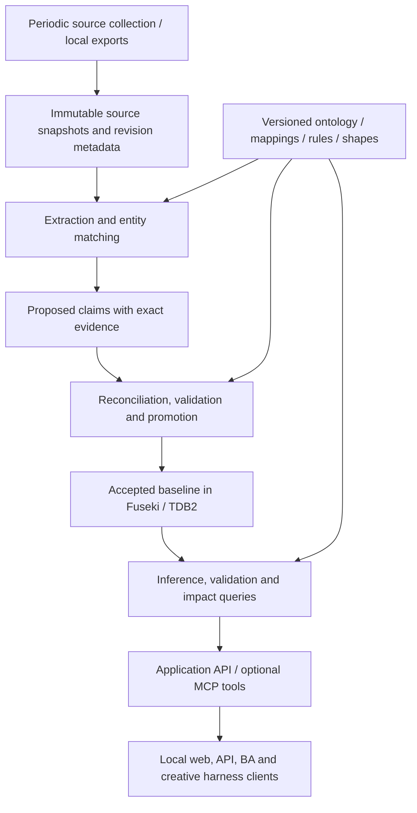

# Local semantic knowledge service pilot — plan and cross-account handoff

Prepared: 21 November 2026. Status: discovery and proposed architecture; implementation has not started.

This document is self-contained. Import it into the work environment first. The companion `conversation-transcript.md` preserves the conversation that led here. Neither file depends on the original OpenAI account, Astra, or a specific model. The user is changing computers, accounts and models.

## Start here: instructions for the next agent

Help deliver a local pilot of a shared semantic knowledge and coordination service for airline software delivery. The immediate next action is to inventory the available local evidence for the existing account landing slice: a Next.js mock, Java APIs/specifications owned by the user, and supporting requirements/design material. Ask where those artifacts are located on the work machine; their paths and contents have not been provided.

Read the confirmed context below before proposing technology or asking questions. Do not restart discovery about organisational ownership, enrolment, the two slices, or local versus remote deployment: those have been clarified. Progress toward a concrete pilot using real source examples. Do not infer business rules or field ownership that the sources have not established.

No service has been deployed, source connectors built, business artifacts ingested, ontology accepted, or inference behaviour tested. The conversation produced this plan, not an implementation. The airline's actual repositories and documents were not inspected. Repository inspection covered only JSSGDBC planning and README material.

## 1. Confirmed purpose

The user works for an airline building a small-business loyalty rewards system. Delivery teams have well-defined ownership but work in silos, imposing significant alignment costs. Their accumulated context exceeds individual model context windows and is dispersed across desktop tools, chats, CLIs, repositories and document systems.

The objective is a shared, versioned, cited record of what each source says, including changes, interpretations, collisions and resolutions. Distributed agents should retrieve specific, current, bounded knowledge and act in alignment. A knowledge graph alone is insufficient: ingestion, reconciliation, freshness, ownership and a common client protocol are part of the service.

The user describes the landscape as complicated rather than complex. Reconstructing what was agreed and identifying misunderstanding is the priority. Existing agreements should be checked against evidence, not treated as absent or unnecessarily redesigned.

### Teams and systems

- Product/business.
- Design, creative and communications.
- Business analysts.
- Web/digital: server-side-rendered Node.js application with a bundled BFF; a reasonably resolved Next.js mock exists.
- Integration: Spring Boot Java API facades, with separate design and implementation staff. The user owns Java APIs in scope.
- Systems of record and identity: Ping One, Salesforce, Sabre and Amadeus Loyalty.
- Enterprise architecture and platform teams.
- Potential evidence sources include GitHub, GitLab, Confluence, Figma, API specifications and code. The precise available pilot sources and export/API formats are still to be inventoried.

### Deployment path — confirmed

1. Local-only pilot: the user periodically ingests disparate streams locally, tracking changes over time.
2. Local cross-functional harness/skill set, potentially curated by intent: web, API, BA, creative.
3. Later: platform-team hosting in Kubernetes on EKS, with plugins/skills distributed to teams using Codex, Claude or similar.

The prototype should use a service boundary from the start so remote deployment does not require redesigning clients. The interpretation that local-only permits hosted-model extraction has NOT been confirmed. Whether company material may be sent to a hosted model remains an open decision.

## 2. The two pilot slices — confirmed

### Slice A: existing login and account landing journey

- A business account has already been created manually. Enrolment is NOT the pilot journey.
- A test account logs in through Ping One.
- The web application calls an API under development and displays the business-account landing page.
- The web team has a reasonably resolved Next.js mock that the user intends to bring in locally.
- Java APIs owned by the user are being developed through a non-AI workflow.
- Account/profile information spans Amadeus Loyalty, Salesforce and Ping. Exact field authority and mappings must be established from evidence.
- The JWT cannot carry sufficient profile context within header constraints.
- The path from authenticated identity to the business account and additional profile context is largely agreed. Ingestion and citations may reveal discrepancies, which is the purpose of the exercise.

Role in the pilot: reconstruct and test an existing cross-team agreement. Compare design intent, documented contracts, implementation behaviour and verification evidence. Avoid making ongoing development dependent on the pilot.

### Slice B: untouched Trips API

- No work has been done on this second slice according to the user.
- Trips API talks to Sabre.
- Its stated purpose is: **"what trips have points been used for."**
- This is the real prospective end-to-end test of the knowledge-assisted workflow.

Do not reinterpret this as points earned from travel. Trip granularity, qualifying points usage, account access, cancellations, reversals and cross-system reconciliation are questions to establish from sources. Do not assume Sabre alone owns reward usage merely because the API talks to Sabre.

## 3. Core design principles

1. **Claims with evidence precede accepted facts.** Preserve what a source said separately from whether the organisation accepts it.
2. **No silent conflict resolution.** Record competing claims and their owners. A newer or more polished artifact is not automatically authoritative.
3. **Deduplicate meaning without discarding citations.** Equivalent claims may share a canonical concept while retaining all source evidence. Similar wording is insufficient to establish equivalence.
4. **Separate intended, implemented and verified behaviour.** A mock is not proof of a business rule; code is not proof that the agreed requirement was met.
5. **Explicit knowledge boundaries.** Answers identify baseline, source coverage, freshness, status and gaps.
6. **Deterministic consequences, fallible extraction.** Logical checks can be reproducible over fixed inputs. AI extraction, semantic matching and suspected-collision detection remain fallible.
7. **Portable clients, central semantics.** Role-specific skills use common service contracts, identifiers and policies. They do not maintain independent truths.
8. **History is first-class.** Source changes, extraction changes, accepted decisions and derived results must be distinguishable.

## 4. Proposed architecture — to validate during the pilot

Suggested local components:

- Docker Compose as the initial deployment mechanism.
- Jena Fuseki with TDB2 for RDF storage and SPARQL access.
- A small application service for ingestion orchestration, claims, baselines, reconciliation and client contracts. Language/framework is undecided.
- Files or object-style local storage for original evidence snapshots.
- A small relational store if useful for jobs, cursors and operational metadata; do not force every operational concern into RDF.
- A periodic scheduler and explicit manual ingestion command. Frequency is undecided.
- Localhost API/MCP access. Harness clients do not open TDB2 files directly.

Jena is the proposed reference implementation, not a confirmed complete solution for every reasoning requirement. No release version has been selected. Pin and verify dependencies during implementation.

### Separate three responsibilities

| Layer | Responsibility |
|---|---|
| Knowledge base | Concepts, claims, relationships, provenance, ontology and history |
| Coordination service | Baselines, proposals, authority, conflicts, freshness and impact |
| Harness/plugin | Role-specific workflows that consume the shared contract |

## 5. Evidence, claims and baselines

### Minimum source record

- Stable source identity and source-system type.
- Original URI or artifact reference.
- Source revision/version where available; content hash for snapshots/exports.
- Source-modified time when supplied; local collection time separately.
- Original snapshot reference and content type.
- Collection success, coverage and access metadata.
- Precise evidence anchors: passage/section, Figma node, OpenAPI path/schema element, or code location tied to a commit/revision.

### Minimum claim record

- Stable claim identity and subject/predicate/object or structured proposition.
- Scope: journey, system, environment, release or other applicable boundary.
- One or more evidence anchors and source revisions.
- Direct assertion versus extracted interpretation versus logical derivation.
- Extraction run, model/prompt/configuration version where relevant.
- Owner and authority basis; these are not necessarily identical to the source author.
- Disposition: proposed, accepted, disputed, superseded; rejected/withdrawn states may be added explicitly.
- Relevant times: source time, observation time and effective interval if explicitly supported.
- Relations to equivalent, contradicting, superseding or derived claims.

Ontology packs, sources, candidate claims, accepted assertions and derived conclusions should have distinct identities and graph scope. Named graphs are useful containers, but do not by themselves provide claim-level provenance or access control.

### Accepted baseline

A baseline identifies a coherent accepted assertion set, ontology/import versions, mapping versions, rule/shape versions and relevant source coverage. Keep derived outputs associated with that baseline. Do not mix changing inputs during a task's initial read.

Each query response should include:

- Baseline ID.
- Answer and status: accepted, proposed, disputed, unknown, etc.
- Supporting citations and source revisions.
- Derivation/rule references for inferred answers.
- Source synchronization times and pending-processing indicators.
- Coverage gaps and known relevant unresolved conflicts.

"Current" means current within explicitly synchronized and processed sources. It does not imply knowledge of inaccessible or uncollected updates. A deterministic result is only as reliable as its accepted inputs and formalization.

## 6. Periodic ingestion and reconciliation

1. Collect revisions using source cursors/version IDs where possible; hash local exports otherwise.
2. Persist snapshots and collection receipts before extraction.
3. Extract candidate claims, preserving anchors and scope.
4. Match entities and compare claims against the prior state.
5. Classify additions, alterations, proposed equivalences, suspected conflicts and withdrawals.
6. Validate structure and semantic constraints; attach findings to evidence and owners.
7. Apply an explicit promotion policy and publish a baseline.
8. Report impacts on contracts, UI fields, tests, decisions and active work.

Important handling:

- A partial/failed fetch is not evidence of deletion.
- A source deletion or revision does not erase its historical statements.
- Re-running the same input should not duplicate claims or citations.
- An extraction-model change is a new interpretation run even when the source is unchanged.
- Apparent collisions need checks for differing scope, effective dates and terminology before being declared contradictions.
- Preserve unresolved interpretations rather than silently forcing a match.
- Initially rebuild derived results for a baseline to simplify retraction correctness. Optimize incremental reasoning later if measurements justify it.

The user's exact promotion policy is unconfirmed. Proposed pilot default: the user curates acceptance across streams while the real organisational ownership remains recorded. Structural validity or model confidence alone should not establish business acceptance.

## 7. Ontology and reasoning strategy

### Start with delivery coordination

Initial concepts:

- Requirement, business rule, acceptance criterion.
- Journey, screen, interaction state, UI field.
- API, operation, request/response field, error contract.
- System, source of record, ownership, identifier and mapping.
- Decision, assumption, unresolved question and conflict.
- Implementation artifact and verification evidence.
- Source, revision, claim, baseline and derivation.

Add a small account/loyalty/trips domain module as evidence requires. Keep authenticated identity, business-account association, profile and authorization conceptually distinct. Do not invent their system mappings.

### A pack is more than an OWL file

Proposed contents: ontology; pinned imports; supported reasoning features; SHACL shapes; rules; source mappings; example instances; expected inference and validation fixtures; provenance/license; version and migration notes.

Candidate reuse sources, not yet selected or imported:

| Candidate | Relevance |
|---|---|
| OSLC vocabularies | Requirements and lifecycle relationships |
| PROV-O | Evidence, attribution and derivation |
| IATA AIDM | Airline vocabulary/model reference; assess representation and reuse terms |
| Schema.org travel vocabulary | Lightweight travel interoperability where suitable |
| FIBO | Future finance-domain exploration; not a dependency of this pilot |

These assets are not interchangeable ready-to-run OWL packs. Curated mappings and reasoning compatibility checks are required. Avoid broad equivalence declarations without evidence.

### Keep inference and validation distinct

- RDFS/selected OWL constructs: classification and supported entailments.
- SHACL and explicit checks: required properties, contract completeness and data constraints.
- Versioned SPARQL/rules: dependency traversal, impact and project-specific checks.
- AI: candidate extraction, mapping and semantic-collision suggestions, with evidence and review.

OWL's open-world semantics do not establish that absent information is false. Completeness checks must specify their source coverage and baseline. Jena's built-in OWL reasoners are incomplete; loading an OWL file does not demonstrate support for all its semantics. Test the exact required entailments. Do not claim complete OWL 2 reasoning or assume all named graphs automatically participate in inference.

Only evaluate alternatives or a separate reasoner when concrete pilot requirements expose a gap. RDFox was identified as an option to investigate for incremental rule reasoning, not selected.

## 8. Harness protocol and role packs

Proposed service operations (not existing Jena features):

| Operation | Purpose |
|---|---|
| `get_task_context` | Bounded evidence package at a consistent baseline |
| `query_accepted_knowledge` | Specific scoped query with status and citations |
| `explain_assertion` | Source evidence and derivation |
| `propose_change` | Proposed claim, correction, mapping or resolution |
| `assess_change_impact` | Affected requirements, artifacts and active work |
| `check_baseline` | Relevant accepted changes since task start |
| `record_verification` | Evidence tied to implementation and requirement revisions |

Workflow:

1. Acquire task context and baseline.
2. Work while recording relevant knowledge dependencies.
3. Submit discoveries/ambiguities as proposals.
4. Reconcile decisions through recorded ownership.
5. Check baseline changes before declaring completion or merging.
6. Attach implementation and verification evidence.

Common skill foundation: citations, baseline/freshness handling, uncertainty, proposal submission and evidence recording. Role views:

- BA/product: reconcile requirements, clarify semantics, trace decisions.
- Creative/design: compare journey states and promises against accepted rules.
- Web/BFF: retrieve behaviour and contract constraints; trace UI fields.
- API/integration: compare mappings, identifiers and system-of-record assumptions.

Skills should work across supported harnesses without model-specific assumptions. CI/delivery checks can later enforce consequential gates; instructions alone do not guarantee compliance. No agents or sub-agents have been commissioned to implement the pilot yet.

## 9. Milestones and acceptance evidence

### M1 — Evidence and history for the account landing slice

Inventory representative source artifacts and owners. Ingest local snapshots with revision metadata and citations. Establish a small manually checked reference set.

Acceptance:

- Trace a displayed landing-page value to UI/mock evidence, API contract/mapping and stated source of record, or report an explicit gap.
- Reconstruct the agreed identity-to-account/profile flow without inventing missing links.
- Retrieve exactly what a selected source said in two revisions.
- Re-ingestion does not duplicate unchanged evidence.
- A collection failure is reported as stale/incomplete, not as deletion.

### M2 — Semantic baseline and reconciliation

Create the minimal ontology, claim model and validation rules. Curate accepted claims and implement collision/change reporting.

Acceptance:

- Keep two conflicting source statements independently cited.
- Distinguish a real disagreement from a scope/date difference on curated examples.
- Merge equivalent meaning without losing either citation.
- Distinguish intended, implemented and verified behaviour.
- Recompute conclusions after a supporting claim is superseded or withdrawn.
- Return repeatable query/check results for fixed accepted inputs, rules and versions.

### M3 — Local distributed-harness trial using Trips

Establish the exact meaning of "what trips have points been used for" from sources and owner decisions. Use separate local web/BFF and API/integration sessions consuming the same service.

Acceptance:

- Both sessions obtain the same accepted relevant business meaning and contracts.
- Each sees source citations and unresolved gaps.
- An introduced source/decision change identifies affected work.
- A stale completion attempt is detected by a baseline check.
- Resulting artifacts and tests link to the applicable requirement revisions.

Do not count a fabricated agreement or an agent-generated summary as proof. Use manually checked examples and concrete artifact/test evidence. Where the real corpus lacks a needed edge case, use clearly marked synthetic fixtures.

### M4 — Remote deployment readiness (later)

Package deployment for the platform team, test backup/restore and document authentication, source access, operational monitoring and client configuration. Initial EKS design should use a single database-owning service instance with persistent storage; do not assume multiple Fuseki instances can share TDB2 files as a scaling mechanism.

Capture source access metadata during the local pilot so later retrieval can enforce access to both evidence and derived information. Shared hosting remains future work, not a prerequisite for M1–M3.

### Evaluation measures

- Citation correctness and revision accuracy.
- Extraction precision/recall on the curated reference set.
- Entity-linking and false-merge errors.
- Collision detection quality and unresolved ambiguity count.
- Freshness lag and failed-ingestion visibility.
- Correct withdrawal of obsolete conclusions.
- Review effort and usefulness to actual cross-team tasks.

Thresholds, corpus size and performance targets are not agreed. Start with a small representative set and set targets from observed behaviour.

## 10. JSSGDBC — subordinate workstream

Original project: JavaScript Semantic Graph Database Connectivity, a uniform async SPO/named-graph facade inspired by JDBC-like connectivity. ESM packages provide core, memory, file, SPARQL and Neo4j adapters.

Inspected `.gsd` records report completed core/memory, file, SPARQL and Neo4j milestones. Root README is behind that state and labels remote adapters as future work. `.gsd/STATE.md` lists all four milestones complete; `.gsd/PROJECT.md` contains an older closeout-pending description for Neo4j. These were read as planning records, not independently revalidated by running tests in this conversation.

Current public abstraction: `Client → Graph → triple CRUD/wildcard find`. SPARQL adapter is triple-pattern oriented, with buffered results and no general inference/ontology management contract. Recorded SPARQL integration evidence uses an offline fixture rather than live Fuseki interoperability.

Use existing functionality when useful, but do not force the coordination service into a lowest-common-denominator driver API. Possible later extensions: capability discovery, RDF term fidelity, general SPARQL, bulk operations, explicit inference views. Requirements should come from the pilot. Ontology governance and promotion remain service-level concerns.

The original checkout's `.gsd` is a symlink to machine-local Open GSD state. These two handoff files are deliberately self-contained; importing them does not require that external state directory. No GSD state or application code was changed for this handoff.

## 11. Open decisions — ask only when needed

Immediate:

1. Where are the work-machine copies of the Next.js mock, Java APIs/specifications and supporting design/requirements evidence?
2. Which sources can be exported locally, and which should use API collection?
3. May hosted models process the material, or must extraction remain on-device? Local service hosting alone does not answer this.
4. What can be used as sanitized test fixtures for identity/profile/API shape? Credentials or live tokens are not needed.

After inventory:

- Initial ingestion cadence and freshness expectations.
- Pilot acceptance/promotion workflow and whether the user will curate all streams.
- Claim granularity, canonical identifiers and source-specific authority rules.
- Actual Trips semantics and required Sabre/loyalty/account relationships.
- API/MCP packaging and target harness versions.
- Required inference constructs and explanation detail.

Later:

- EKS deployment constraints, authentication, access policy, backup/restore objectives and operating ownership.

## 12. Research references from this conversation

These were consulted during initial exploration. Recheck implementation-specific details and versions when building.

- [Jena overview](https://jena.apache.org/documentation/)
- [Fuseki](https://jena.apache.org/documentation/serving_data/)
- [TDB2](https://jena.apache.org/documentation/tdb2/index.html)
- [Fuseki Docker tooling](https://jena.apache.org/documentation/fuseki2/fuseki-docker.html)
- [Jena inference and limitations](https://jena.apache.org/documentation/inference/)
- [Jena SHACL](https://jena.apache.org/documentation/shacl/)
- [OWL 2 primer: open-world semantics](https://www.w3.org/TR/owl2-primer/)
- [PROV-O](https://www.w3.org/TR/prov-o/)
- [OSLC vocabularies](https://www.open-services.net/specifications/vocabularies/)
- [IATA AIDM](https://www.iata.org/aidm)
- [FIBO](https://edmcouncil.org/frameworks/industry-models/fibo/)
- [Schema.org LodgingReservation](https://www.schema.org/LodgingReservation)
- [RDFox reasoning](https://docs.oxfordsemantic.tech/reasoning.html)

## Suggested prompt after import

> Read this plan as the current handoff and consult the companion transcript for original wording. Help me implement the local pilot, beginning with an inventory of the actual account landing evidence on this machine. Preserve the confirmed scope: existing login/account landing for reconstruction, then an untouched Trips API talking to Sabre for what trips points have been used for. Prioritize citations, revision history, conflicting interpretations and shared baseline queries. Identify proposals versus confirmed decisions. Do not start with enrolment, assume complete OWL reasoning, or make JSSGDBC extensions a prerequisite. Ask me for artifact locations and the hosted-model data-processing boundary, then propose the smallest concrete implementation slice based on what is available.
